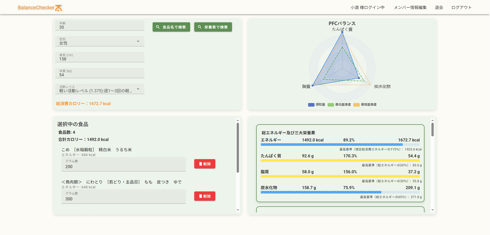
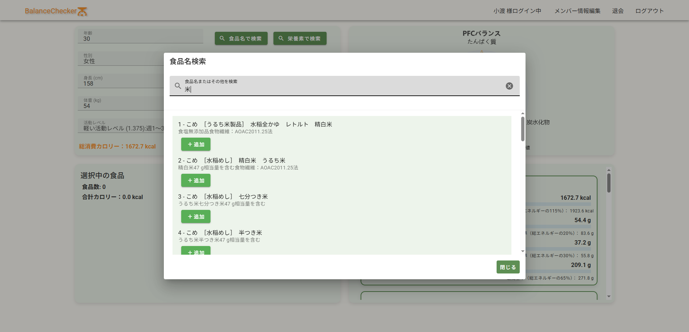
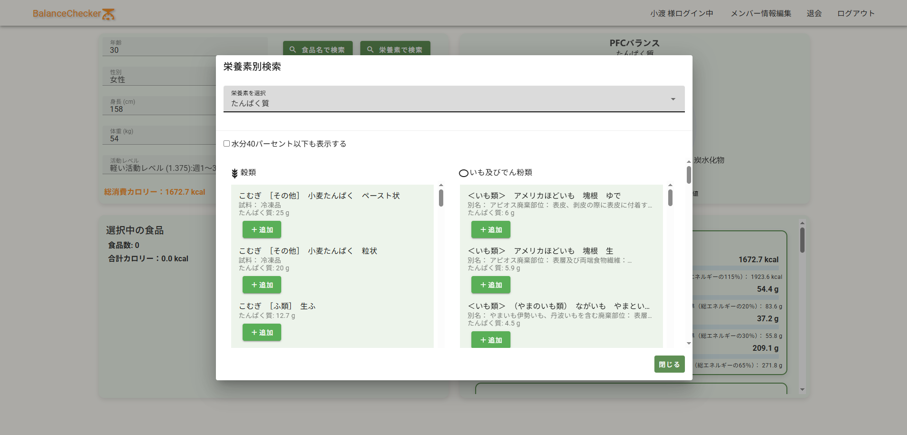

# BalanceChecker

年齢・性別・体格・活動量と、選択した食品の栄養情報をもとに、1日に必要な栄養素の充足率をリアルタイムで確認できるWebアプリケーションです。

約2,500種類の食品データを収録し、消費カロリーの計算、食品検索、栄養素別ランキング、摂取量の可視化を一つの画面にまとめています。会員登録をしなくても、ゲストアカウントですぐに主要機能を試せます。

## 開発背景

栄養管理をする際は、消費カロリーの計算、年代・性別ごとの摂取基準、食品ごとの栄養情報を別々のWebサイトで調べる必要がありました。

そこで、必要な情報の検索と計算を一つの画面で完結させ、食品を選ぶだけで栄養バランスを直感的に確認できるアプリを開発しました。

## 主な機能

- 年齢・性別・身長・体重・身体活動レベルから総消費カロリーを計算
- 食品名のインクリメンタルサーチ
- 栄養素を指定した食品ランキング検索
- 選択した食品の重量変更・削除
- 選択食品のカロリーと各栄養素を自動集計
- 摂取基準に対する充足率をプログレスバーで可視化
- 会員登録、ログイン、会員情報編集、退会
- 登録不要のゲストログイン

## セキュリティ対応

- パスワードをPBKDF2-HMAC-SHA256でハッシュ化して保存
- 旧形式の平文パスワードを、正常ログイン時にハッシュへ自動移行
- DB接続パスワードをソースコードから分離
- 認証フィルターによる未ログイン時のアクセス制御
- JSPへの直接アクセスを禁止し、コントローラー経由に統一
- CSRFトークンによるPOSTリクエストの検証
- ログアウトをGETからCSRF保護されたPOSTへ変更
- 確認画面でのパスワード再表示を廃止
- SQL操作にPreparedStatementを使用

## 使用技術

| 分類 | 技術 |
| --- | --- |
| フロントエンド | Vue.js 3、Vuetify 3、Axios |
| バックエンド | Java 17、Servlet/JSP、JSTL |
| データベース | PostgreSQL |
| Webサーバー | Apache Tomcat 9 |
| 開発環境 | Eclipse、Visual Studio Code |

## 画面イメージ

### トップ画面



### 食品名検索



### 栄養素別検索



## 操作デモ

[YouTubeで操作デモを見る](https://youtu.be/jLj7YZO4Xu8)

## ローカル実行時の設定

Java 17、Tomcat 9、PostgreSQLが必要です。データベースの接続情報はソースコードに保存せず、環境変数またはJavaシステムプロパティで指定します。

| 環境変数 | Javaシステムプロパティ | 必須 | 既定値 |
| --- | --- | --- | --- |
| `BALANCECHECKER_DB_PASSWORD` | `balancechecker.db.password` | はい | なし |
| `BALANCECHECKER_DB_URL` | `balancechecker.db.url` | いいえ | `jdbc:postgresql://localhost:5433/foods_db` |
| `BALANCECHECKER_DB_USER` | `balancechecker.db.user` | いいえ | `postgres` |

EclipseからTomcatを起動する場合は、サーバーの起動構成に次のように追加します。

```text
-Dbalancechecker.db.password=データベースのパスワード
```

必要に応じてURLとユーザー名も同じ形式で指定してください。設定後、Tomcatへプロジェクトを追加して起動し、次のURLを開きます。

```text
http://localhost:8080/balanceChecker/login
```

## 設計上のポイント

- 画面表示はServletからJSPへフォワードし、JSPを直接公開しない構成
- DAO・Service・Controllerを分離し、画面処理とDB処理の責務を整理
- 食品検索APIの結果をVue.jsで反映し、ページ遷移を抑えた操作感を実現
- 会員とゲストの状態をセッションで明確に分離

## 開発期間・継続改善

- 初期開発：2025年4月12日〜2025年4月27日（約16日間）
- 継続改善：2026年11月

初期開発後にコードレビューを行い、生成AI（OpenAI Codex）を開発支援として活用しながら、次の改善を実施しました。

- パスワードのハッシュ化とDB接続情報の環境変数化
- 認証制御、CSRF対策、JSP直接アクセス制限の追加
- ゲストログイン機能の追加
- 食品検索画面、栄養素別検索画面、ログイン画面の操作性改善
- 不要な表示や処理の整理
- READMEなどのドキュメント整備

生成AIの提案をそのまま採用するのではなく、変更内容とコードの差分を確認し、ローカル環境で会員登録、ログイン、編集、退会、食品検索、栄養計算など主要機能の動作検証を行っています。

## 今後の改善案

- 食品ごとの詳細画面
- モバイル向けレイアウトの強化
- 目標に応じたおすすめ食品の提案
- 自動テストとCIの導入

## データソース・参考文献

- 文部科学省「[日本食品標準成分表（八訂）増補2023年](https://www.mext.go.jp/a_menu/syokuhinseibun/mext_00001.html)」
- 厚生労働省「[日本人の食事摂取基準（2025年版）策定検討会報告書](https://www.mhlw.go.jp/stf/newpage_44138.html)」
